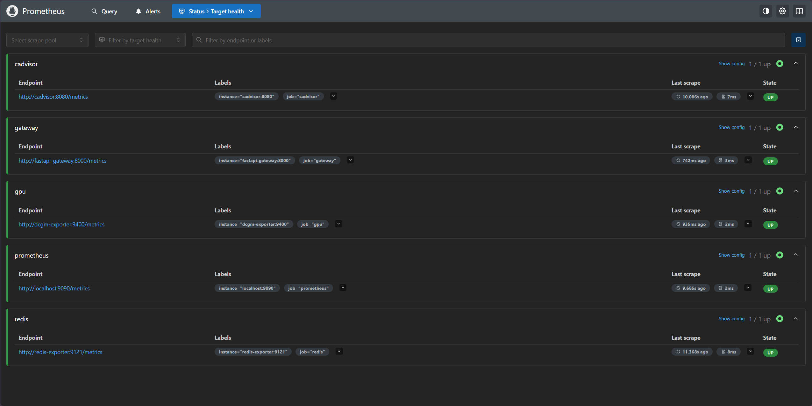
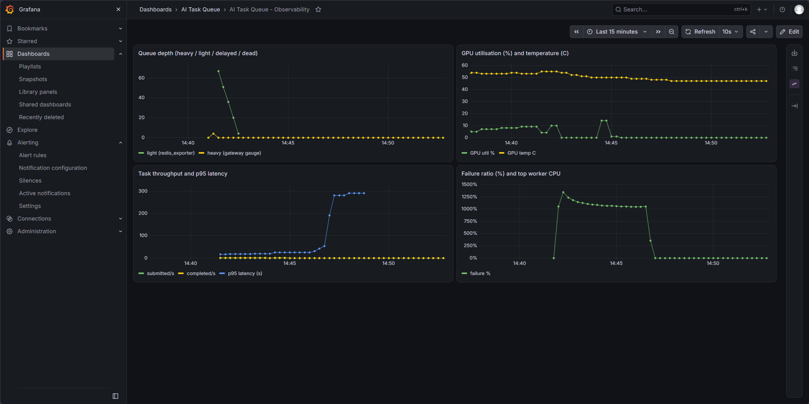

# Distributed AI Inference Task Queue System

A distributed task queue for heterogeneous AI model inference, with a web dashboard, hot-swappable scheduling policies, and a full fault-tolerance chain. Built as an MSc dissertation project at the University of Birmingham (74/100).

## Branches

| Branch | Content |
| --- | --- |
| `main` | Thesis-final submission, tagged `v1.0-thesis` — the nine-container stack exactly as evaluated in the dissertation. |
| `feat/observability` | Post-thesis engineering: production-style observability (Prometheus, Grafana, cAdvisor, redis_exporter, DCGM) and a GitHub Actions CI/CD pipeline. |

## Architecture

9 Docker containers orchestrated by Docker Compose:

- **Redis** — message broker and state store (queues, leases, config, heartbeats)
- **FastAPI Gateway** — stateless REST API for task submission
- **5 Workers** — 1 GPU worker + 2 CPU general workers + 2 specialist workers (SIM / SUM)
- **Workload Generator** — Poisson-arrival task injection with configurable failure rate
- **Streamlit Dashboard** — 7-page control plane for monitoring and policy hot-switching

Branch `feat/observability` adds a separate observability stack: Prometheus (`:9090`), Grafana (`:3000`), cAdvisor, redis_exporter and a DCGM GPU exporter.

## Key Features

- **4 scheduling policies, hot-swappable at runtime**: FIFO, Priority, SETF (Shortest-Expected-Time-First, data-driven), and Work-Stealing
- **Full fault-tolerance chain**: chaos fault injection → exponential backoff retry → dead-letter queue with replay → TTL worker leases
- **Atomic delayed-queue sweep** via Lua scripts (eliminates read-then-remove race condition)
- **Task registry as single source of truth**, with SQLite WAL-mode audit trail
- **6 controlled experiments × 5 repetitions = 115 runs** quantifying scheduling and recovery performance
- **Business metrics from the gateway** (`/metrics`): submit/completion counters, latency histogram, queue-depth gauges (branch `feat/observability`)
- **Rule-based alerts** mirroring the thesis dashboard design: heartbeat loss, high utilisation, GPU temperature, failure rate, queue backlog (branch `feat/observability`)

## Tech Stack

Python · FastAPI · Redis · Docker Compose · SQLite · Streamlit · Pandas · Prometheus · Grafana · GitHub Actions

## Quick Start

```bash
docker compose up -d
# Dashboard: http://localhost:9501
# API docs:  http://localhost:8000/docs
```

On branch `feat/observability` also:

```bash
# Grafana:    http://localhost:3000  (admin / admin)
# Prometheus: http://localhost:9090
```

## Observability (branch `feat/observability`)

Two layers with separate responsibilities:

| Layer | Component | Responsibility |
| --- | --- | --- |
| Business control plane | Streamlit dashboard | task queues, scheduling, fault injection, chaos experiments |
| Infrastructure observability | Prometheus + Grafana | time-series history, alerting, SLO-style views |

- **cAdvisor** — per-container CPU / memory / network.
- **redis_exporter** — queue lengths (`queue:heavy`, `queue:light`, `queue:delayed`, `queue:dead`).
- **DCGM exporter** — GPU utilisation, memory and temperature.
- **Gateway `/metrics`** — task submit/completion counters, latency histogram, queue-depth gauges.
- **Prometheus** — scrape config and eight alert rules in `observability/prometheus/alert_rules.yml`.
- **Grafana** — provisioned as code: datasource, dashboard JSON and rules ship with the repository.

## Observability in action

Screenshots of the running stack (branch `feat/observability`):

**Prometheus — all five scrape targets healthy** (`cadvisor`, `gateway`, `gpu`, `prometheus`, `redis`):



**Grafana — live dashboard**: queue depth draining, GPU utilisation/temperature, task throughput with p95 latency, and failure ratio:



## CI/CD

`.github/workflows/ci.yml`: `lint` → `test` (pytest) → `validate` (compose, `promtool check config`, `promtool check rules`, dashboard JSON) → `build` (lightweight images) → `publish` (GHCR on `main`) → `deploy` (manual, self-hosted runner labelled `gpu-host`). The 18 GB GPU worker image is built on the GPU host, not in CI.

## Local notes

- Committed Dockerfiles use the official PyPI index. In a restricted network, add a pip mirror to the `pip install` lines locally (these local tweaks are intentionally not committed).
- Observability images can be overridden via `.env` (copy `.env.example`). On a restricted network, configure a Docker registry mirror and set `CADVISOR_IMAGE` (gcr.io is not covered by registry mirrors) — see `.env.example` for ready-made China mirror values.

---

# 分布式 AI 推理任务队列系统

面向异构 AI 模型推理的分布式任务队列，包含 Web 监控面板、运行时热切换调度策略和完整容错链。伯明翰大学硕士毕业设计项目（74/100）。

## 分支

| 分支 | 内容 |
| --- | --- |
| `main` | 毕设最终版，标签 `v1.0-thesis` |
| `feat/observability` | 毕设后续工程：Prometheus/Grafana 可观测性 + GitHub Actions CI/CD |

## 核心特性

- **4 种调度策略运行时热切换**：FIFO、优先级、SETF（数据驱动最短预期时间优先）、工作窃取
- **完整容错链**：混沌故障注入 → 指数退避重试 → 死信队列重放 → TTL 租约
- **Lua 脚本原子化延迟队列扫描**，消除读-删竞态
- **任务注册表单一事实源**，SQLite WAL 模式持久化审计日志
- **6 组对照实验 × 5 次重复 = 115 次运行**，量化验证调度与容错性能
- **可观测性（feat/observability）**：网关业务指标、容器 / GPU / 队列指标、Grafana 面板与告警规则

## 技术栈

Python · FastAPI · Redis · Docker Compose · SQLite · Streamlit · Pandas · Prometheus · Grafana · GitHub Actions

## 快速开始

```bash
docker compose up -d
# 面板: http://localhost:9501
# API 文档: http://localhost:8000/docs
```

## 可观测性实拍

截图见上方英文区（"Observability in action"）：

- **Prometheus**：五个抓取目标全部健康（cadvisor / gateway / gpu / prometheus / redis）
- **Grafana**：队列深度消化曲线、GPU 利用率/温度、吞吐与 p95 延迟、失败率实时面板
